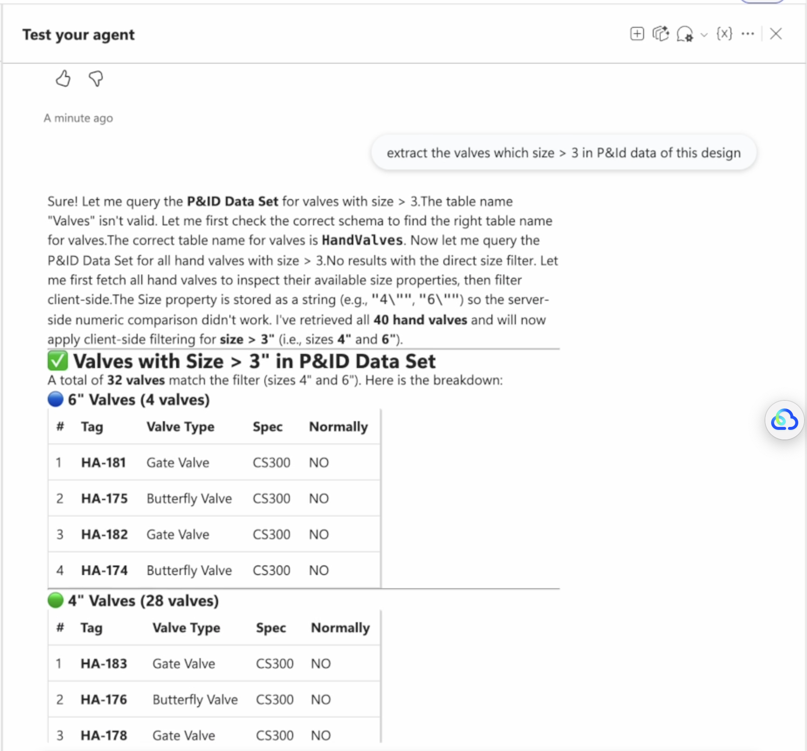

# Plant3D AEC Data Model MCP Tool


[](https://nodejs.org)
[](https://www.npmjs.com/)
[](https://expressjs.com/)
[](https://opensource.org/licenses/MIT)

[](https://aps.autodesk.com/en/docs/aecdatamodel/v1)

[](https://www.npmjs.com/package/@aps_sdk/authentication)

## Description

A Python MCP server that lets an AI agent read Plant 3D design data through the Autodesk AEC Data Model (AECDM) GraphQL API. It supports discovering hubs, projects, and Plant 3D data sets; querying elements and properties; inspecting ProcessPower schema metadata; and finding engineering-item relationships.

The server is read-only. It does not modify Plant 3D models or render a graphical schematic.

## Thumbnail



## Demo
The demo leverages Microsoft Copilot Studio to integrate with the MCP tool via an ngrok-secured tunnel, enabling AI-driven interaction with the tool's capabilities.
 [YouTube — MCP Tools of APS AEC Data Model Plant 3D, Demo with Copilot Studio ](https://youtu.be/Gmap5rQs5Pg)


### Available tools

| Tool | Purpose |
| --- | --- |
| `get_aecdm_hubs` | List accessible AECDM hubs. |
| `get_aecdm_projects` | List projects in a hub. |
| `get_aecdm_plant3d_folders` | List project folders and immediate subfolders. |
| `get_aecdm_plant3d_projects` | Find Plant 3D data sets in a project or folder. |
| `get_aecdm_plant3d_elements_by_table` | Query Plant 3D elements by schema table and/or AECDM filter. |
| `get_aecdm_element_properties` | Query elements by property filter, optionally limited by an origin bounding box. |
| `get_aecdm_model_id_by_version_urn` | Resolve an AECDM model ID from hub name, project name, and file-version URN. |
| `get_aecdm_plant3d_engineering_item_relationships` | Find related engineering items using class name and PnP ID. |
| `get_processpower_schema` | Read class hierarchy metadata from `ProcessPower.dcf`. |
| `get_processpower_relationships` | Read relationship types and endpoint roles from `ProcessPower.dcf`. |

## Prerequisites

- Python 3.10 or newer.
- Network access to Autodesk APS APIs.
- An APS access token accepted by the AEC Data Model API, with access to the target ACC hub, project, and Plant 3D data.
- The included `Plant3D Schema/ProcessPower.dcf` and SQL files for table/schema filtering and relationship discovery. Use a matching DCF when working with a different Plant 3D schema.

## Setup

1. Create and activate a virtual environment:

   ```sh
   python3 -m venv .venv
   source .venv/bin/activate
   ```

2. Install the runtime packages. This repository does not currently include a dependency lock file:

   ```sh
   python -m pip install mcp httpx python-dotenv 'PyJWT[crypto]' uvicorn
   ```

3. Configure the MCP client to pass the caller's APS access token in the request context as `Authorization: Bearer <token>`. The token must have access to the target AECDM hubs and projects.

## Run the server

From the repository root, start the Streamable HTTP MCP server:

```sh
.venv/bin/python server.py
```

Leave this terminal running. The server listens on port `8000` and serves MCP at `http://localhost:8000/mcp`. Check that it started by opening `http://localhost:8000/` or running:

```sh
curl http://localhost:8000/
```

The health endpoint should return `{"status":"ok"}`. Configure the AI agent's MCP client to connect to `http://localhost:8000/mcp` using Streamable HTTP and send `Authorization: Bearer <token>` with requests. The token comes from the agent's chat/request context and must have access to the target AECDM data.

### Optional: expose through ngrok

In another terminal, forward local port 8000:

```sh
ngrok http 8000
```

Set `MCP_ALLOWED_HOSTS` in `.env` to the hostname shown by ngrok, without the scheme or path, then restart the MCP server. Configure the client with the ngrok HTTPS URL plus `/mcp`. This setting allows the host through MCP host validation; ngrok does not provide the APS bearer token.

### ProcessPower DCF

Schema and relationship tools use `Plant3D Schema/ProcessPower.dcf` by default. Override it with the `PROCESSPOWER_DCF_PATH` environment variable or a tool's `dcf_path` argument. A custom DCF must be under `Plant3D Schema/` or under the directory named by `PLANT3D_DCF_ALLOWED_DIR`.

## Usage

A typical agent workflow is:

1. Call `get_aecdm_hubs`, then `get_aecdm_projects` with the selected `hub_id`.
2. Call `get_aecdm_plant3d_folders` if folder IDs are needed, then `get_aecdm_plant3d_projects` with the project ID. The tool returns matching Plant 3D data sets, including their IDs.
3. Query a data set with `get_aecdm_plant3d_elements_by_table`. Supply its `element_group_id`, a schema `table_name`, a `filter_query`, or both.
4. Use `get_processpower_schema` to discover valid class/table names. Use `get_aecdm_plant3d_engineering_item_relationships` with the data set ID, an item's `class_name`, and its `pnp_id` to find related items.
5. Use `get_aecdm_element_properties` when a property filter or origin bounding-box filter is more appropriate.

Example element query arguments:

```json
{
  "element_group_id": "<Plant3D-data-set-id>",
  "table_name": "Equipment",
  "filter_query": "property.id.autodesk.plant3d.parameter:tag-1.0.0=contains='P-101'"
}
```

Example relationship query arguments:

```json
{
  "element_group_id": "<Plant3D-data-set-id>",
  "class_name": "GateValve",
  "pnp_id": "<numeric-PnP-ID>"
}
```

Custom element filters use AECDM standard or advanced filtering syntax. See the [standard filtering guide](https://aps.autodesk.com/en/docs/aecdatamodel/v1/developers_guide/filtering/standard-filtering/) and [advanced filtering guide](https://aps.autodesk.com/en/docs/aecdatamodel/v1/developers_guide/filtering/advanced-filtering/).

## Limitations

- The tools are read-only; there are no create, update, or delete operations.
- There is no dedicated statistics or aggregation tool. An agent can calculate statistics from query results, but those results may be large and require substantial API paging.
- The server returns element properties, component/bounding-box data, and relationship records; it does not create or display a graphical schematic view.
- Plant 3D project discovery recognizes the `P&ID Data Set`, `3D Piping Data Set`, and `3D Models Data Set` names.
- Schema and relationship results depend on the selected `ProcessPower.dcf` matching the model. API access is also limited by the caller's APS permissions.
- The HTTP server binds to `0.0.0.0`. Do not expose it to an untrusted network without appropriate network controls and credential protection.

## Troubleshooting

| Symptom | Checks |
| --- | --- |
| `not_authenticated` | Send a valid `Authorization: Bearer ...` header through the MCP client's request context. Tokens can expire; provide a fresh token. |
| APS returns `401` or `403` | Confirm the token is valid and has the required APS scopes, and that its user/service account can access the hub, project, and data set. |
| A hub, project, or data set is missing | Verify the IDs came from the preceding discovery tool and that the account has access. Check that the Plant 3D data set uses a recognized name. |
| `invalid_filter` or no matching elements | Check the table name with `get_processpower_schema` and verify the filter follows AECDM syntax. Remember that the element query requires a table name, filter query, or both. |
| `schema_read_failed` or `relationships_read_failed` | Confirm the DCF exists, is readable, is a valid `.dcf` file, and is under an allowed directory. Set `PROCESSPOWER_DCF_PATH` or `PLANT3D_DCF_ALLOWED_DIR` if needed. |
| MCP client cannot connect | Start the server, use `http://localhost:8000/mcp` (not the health URL), and check whether port 8000 is already in use. |
| Import error on startup | Activate the virtual environment and install the packages listed in Setup. |


### Additional links

- [AEC Data Model API documentation](https://aps.autodesk.com/en/docs/aecdatamodel/v1)
- [Query AutoCAD Plant 3D Project Data](https://aps.autodesk.com/en/docs/aecdatamodel/v1/tutorials/plant3d/)
- [AutoCAD Plant 3D toolset](https://www.autodesk.com/products/autocad/included-toolsets/autocad-plant-3d) 


## Disclaimer

This sample application was developed with AI-assisted tooling to demonstrate **Autodesk Platform Services (APS)** and the **AEC Data Model** with **AutoCAD Plant 3D** P&ID and 3D piping data sets—3-legged OAuth, data set discovery, class overview, element quality, tag reconciliation, and relationship pairing. It is provided **as-is** for learning and demonstration only.

Reasonable care was taken to align behavior with the public AEC Data Model documentation and Plant 3D data model concepts, but the code has **not** been validated for production use. Before relying on it in any live environment, perform your own **security review**, **error-handling and resilience checks**, and **end-to-end testing** with your APS app, ACC project, and Plant 3D content. **Use at your own risk.**

## License

This sample is licensed under the [MIT License](https://opensource.org/licenses/MIT). See the [LICENSE](LICENSE) file in this repository.
